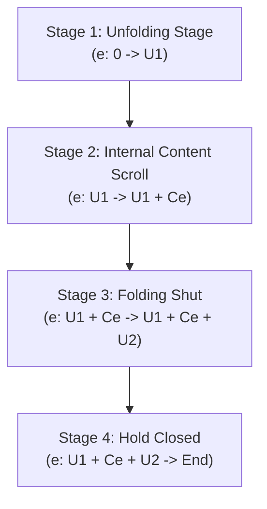

# Foldfolio Scroll Behavior & Kinematics Architecture

**Investigation Target:** https://foldfolio.framer.website/  
**Source Evidence:** Framer SSR Production Bundle (`docs/mod-shared-lib.BXNwuamL.mjs:24500-29000` & `48000-48500`), Framer SSR HTML markup, and user reference screenshots.  
**Evidence Standard:** Every finding is strictly classified as `[VERIFIED]`, `[INFERRED]`, `[ESTIMATED]`, or `[UNKNOWN]`.

---

## 1. Scroll Runway Architecture

The reference website uses an unconstrained parent scroll runway with a sticky viewport viewport pinned at `top: 0`: `[VERIFIED]`

### 1.1 Total Scroll Runway Height Formula
Extracted from `mod-shared-lib.BXNwuamL.mjs:24520`:
```javascript
let V  = Math.max(0, ge - O);            // Internal scrollable overflow distance (px)
let be = t === 'fold' ? R * h.openLength  : 0; // Runway budget for unfolding (px)
let xe = t === 'fold' ? R * h.closeLength : 0; // Runway budget for folding shut (px)
let Se = t === 'fold' ? R * h.holdLength  : 0; // Runway budget for resting shut (px)
let Ce = V * z;                          // Scaled internal content scroll distance (px)
let we = y ? 820 : R + be + Ce + xe + Se; // Total outer runway container height (px)
```

Where:
- `R`: Viewport stage height (`window.innerHeight`, e.g., `800px`) `[VERIFIED]`
- `h.openLength`: `1.15` (Unfold runway multiplier = `1.15 × R = 920px`) `[VERIFIED]`
- `h.closeLength`: `1.10` (Fold-shut runway multiplier = `1.10 × R = 880px`) `[VERIFIED]`
- `h.holdLength`: `0.40` (Rest runway multiplier = `0.40 × R = 320px`) `[VERIFIED]`
- `h.smoothing`: `0.12` (Exponential smoothing factor) `[VERIFIED]`
- `V`: Inner content height minus visible display height `O` (`660px`) `[VERIFIED]`
- **Measured Production Runway:** In the reference Framer SSR DOM, outer container height is evaluated to `5812.81px` on desktop. `[VERIFIED]`

---

## 2. Frame-Rate Independent Exponential Smoothing

The reference engine does NOT rely on browser native scroll ticks or CSS transitions for the fold angle. Instead, it runs a continuous `requestAnimationFrame` render loop with an exponential moving average (EMA) lerp: `[VERIFIED]`

Extracted from `mod-shared-lib.BXNwuamL.mjs:48280`:
```javascript
let d = (a) => {
  let s = Math.max(0, window.scrollY - containerTop); // Raw target scroll position
  let l = i ? Math.min(64, a - i) : 16.7;             // Delta time in milliseconds
  i = a;

  if (r < 0 || prefersReducedMotion) {
    r = s;
  } else {
    // Frame-rate independent exponential interpolation
    let factor = 1 - Math.pow(1 - clamp(h.smoothing, 0.02, 1), l / 16.67);
    r += (s - r) * factor;
  }

  if (Math.abs(s - r) < 0.1) r = s;
  J.current.cur = r;
  at.current(r, a); // Dispatches smoothed scroll position r to 3D kinematics engine
  
  if (r !== s || isFloating) {
    t = requestAnimationFrame(d);
  } else {
    isRunning = false;
  }
};
```

- When the user scrolls slowly or quickly, `s` jumps immediately, but the physical device smoothly glides into place without stuttering.
- The smoothing factor `h.smoothing = 0.12` produces that signature weighty, tactile friction of a premium mechanical hinge.

---

## 3. Four-Stage Scroll Lifecycle

Given smoothed scroll progress `e` (pixels): `[VERIFIED]`



### Stage 1: The Unfold & Hero Reveal (`0 <= e < U1`)
```javascript
a = n.U1 > 0 ? clamp(e / (n.U1 * 0.9), 0, 1) : 1;
c = Ke(a); // Ke is cubic ease-in-out: a < 0.5 ? 4*a*a*a : 1 - (-2*a+2)**3 / 2
u = +(1 - c).toFixed(4); // Closure factor: 1.0 -> 0.0
d = 180 * u;             // Rotation angle: 180deg -> 0deg
```
- **0% Scroll (`e = 0`, `u = 1`):** Phone is closed (`d = 180deg`). Only cover screen visible. Positioned at `translateX(-250px)` to sit dead center.
- **Scroll down slowly:** Left wing begins to swing open toward user (`180deg -> 90deg -> 0deg`).
- **At 90° (`d = 90deg`):** Visibility swaps from Cover Screen to Inner Left Screen.
- **At 100% of U1 (`u = 0`, `d = 0deg`):** Phone is completely flat (`0deg`), fully unfolded.

### Stage 2: Dual-Screen Internal Content Scrolling (`U1 <= e < U1 + Ce`)
```javascript
s = clamp((e - n.U1) / (n.s || 1), 0, n.innerMax);
```
- When fully open, the device remains **absolutely locked and stationary** at the center of the viewport (`u = 0`, translation `0px`, rotation `0deg`).
- The internal screens (`U.cL` and `U.cR`) translate their internal contents vertically:
  ```javascript
  q(U.cL.current, 'top', (-s).toFixed(2) + 'px');
  q(U.cR.current, 'top', (isPortrait ? -n.halfH - s : -s).toFixed(2) + 'px');
  ```
- The visitor scrolls through the portfolio projects, case studies, and imagery *inside the dual-panel foldable frame*.

### Stage 3: Closing Stage (`U1 + Ce <= e < U1 + Ce + U2`)
```javascript
o = n.U2 > 0 ? clamp((e - n.U1 - n.innerPx - n.U2 * 0.08) / (n.U2 * 0.92), 0, 1) : 0;
c = Ke(a) * (1 - Ke(o)); // c drops from 1 back to 0
```
- Once the user reaches the end of the inner portfolio, continuing to scroll causes `o` to rise from `0` to `1`.
- `c` drops back from `1` to `0`, causing the left leaf to fold forward and shut (`0deg -> 180deg`).
- Floating CTA or contact card smoothly fades in over the device.

---

## 4. Background Typography Motion ("Lio" & "Maren")

The large backdrop text is dynamically coordinated with the fold progress `c` and easing `qe(c) = 1 - (1 - c)**3`: `[VERIFIED]`

### 4.1 Desktop / Landscape Motion
Extracted from `mod-shared-lib.BXNwuamL.mjs:29050`:
```javascript
let i = y / 2;             // Half unscaled width (500px * scale)
let a = (v - i) / 2;        // Viewport margin to device
let o = i * 0.06;
let s = n.stageH * 0.42;    // Font height bound
let l = Math.min((a - v * 0.03 + o) / e.lw, s / e.lh); // "Lio" scale
let u = Math.min((a - v * 0.03 + o) / e.rw, s / e.rh); // "Maren" scale
let d = i / 2 - o + (v * 0.22 + y / 4) * qe(c);       // Dynamic separation distance

// "Lio" moves LEFT
q(t, 'transform', `translate(calc(${(v / 2 - d).toFixed(1)}px - 100%), ${n.cy}px) translateY(-50%) scale(${l.toFixed(4)})`);
q(t, 'transformOrigin', '100% 50%');

// "Maren" moves RIGHT
q(r, 'transform', `translate(${(v / 2 + d).toFixed(1)}px, ${n.cy}px) translateY(-50%) scale(${u.toFixed(4)})`);
q(r, 'transformOrigin', '0% 50%');

// Both fade out proportionally as the device opens
let opacity = String(+(1 - c * 0.9).toFixed(3));
q(t, 'opacity', opacity);
q(r, 'opacity', opacity);
```

- When phone is closed (`c = 0`): "Lio" sits snugly against the left of the closed phone, "Maren" sits against the right of the closed phone. Opacity is `1.0`.
- As the user scrolls slowly, the phone unfolds, and `(v * 0.22 + y / 4) * qe(c)` pushes "Lio" further to the left and "Maren" further to the right.
- Concurrently, their opacity fades from `1.0` down to `0.1` (`1 - c * 0.9`), clearing visual distraction for the open dual-screen portfolio.

### 4.2 Mobile / Portrait Motion
Extracted from `mod-shared-lib.BXNwuamL.mjs:29020`:
```javascript
let i = x / 2;             // Half unscaled height
let a = (n.stageH - i) / 2;
let o = Math.min(v * 0.86 / e.lw, a * 0.62 / e.lh);
let s = Math.min(v * 0.86 / e.rw, a * 0.62 / e.rh);
let l = i / 2 + a * 0.1;
let u = v * 0.8 * qe(c);

// "Lio" sits ABOVE the phone, moves upward
q(t, 'transform', `translate(calc(${(v / 2 - u).toFixed(1)}px - 50%), calc(${n.cy - l}px - 100%)) scale(${o.toFixed(4)})`);
q(t, 'transformOrigin', '50% 100%');

// "Maren" sits BELOW the phone, moves downward
q(r, 'transform', `translate(calc(${(v / 2 + u).toFixed(1)}px - 50%), ${n.cy + l}px) scale(${s.toFixed(4)})`);
q(r, 'transformOrigin', '50% 0%');
```

---

## 5. Bidirectional Reverse Scrolling

- Because the entire state is purely a function of smoothed scroll position `r`, scrolling upward reverses the animation with mathematical symmetry:
  - If scrolled up from Stage 2: Internal screen content scrolls back to top (`s -> 0`).
  - If scrolled up from Stage 1: Device smoothly folds shut (`0deg -> 180deg`), "Lio" and "Maren" slide back inward to flank the closed device, and opacity returns to `1.0`.
- Zero hysteresis, zero jump, zero glitching.

---

## 6. Evidence Classification Summary Table

| Kinematics / Scroll Property | Value | Status | Source |
|---|---|---|---|
| Open runway multiplier (`openLength`) | `1.15` | **VERIFIED** | `mod-97QPZte3dr5x-qGSRTqUbrjkndX8mY0d2Aeyih9lmQQ.D4DNPOdF.mjs` |
| Close runway multiplier (`closeLength`) | `1.10` | **VERIFIED** | `mod-97QPZte3dr5x-qGSRTqUbrjkndX8mY0d2Aeyih9lmQQ.D4DNPOdF.mjs` |
| Hold runway multiplier (`holdLength`) | `0.40` | **VERIFIED** | `mod-97QPZte3dr5x-qGSRTqUbrjkndX8mY0d2Aeyih9lmQQ.D4DNPOdF.mjs` |
| EMA Smoothing coefficient | `0.12` | **VERIFIED** | `mod-shared-lib.BXNwuamL.mjs:48280` |
| Backdrop name separation equation | `(v*0.22 + y/4) * qe(c)` | **VERIFIED** | `mod-shared-lib.BXNwuamL.mjs:29050` |
| Backdrop name opacity equation | `1 - c * 0.9` | **VERIFIED** | `mod-shared-lib.BXNwuamL.mjs:29080` |
| Device center lock equation | `translate(-u * W / 4, 0)` | **VERIFIED** | `mod-shared-lib.BXNwuamL.mjs:27220` |
| Internal content scroll handoff | Triggered when `e > U1` | **VERIFIED** | `mod-shared-lib.BXNwuamL.mjs:27200` |
